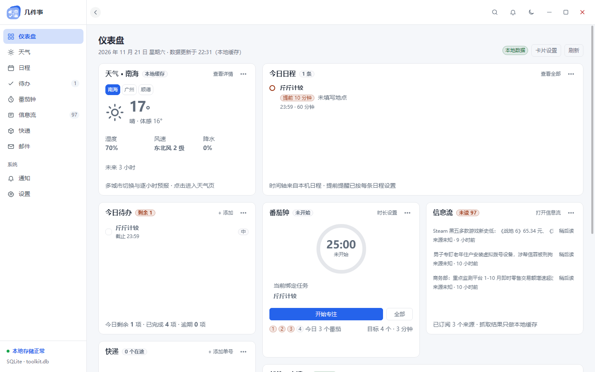
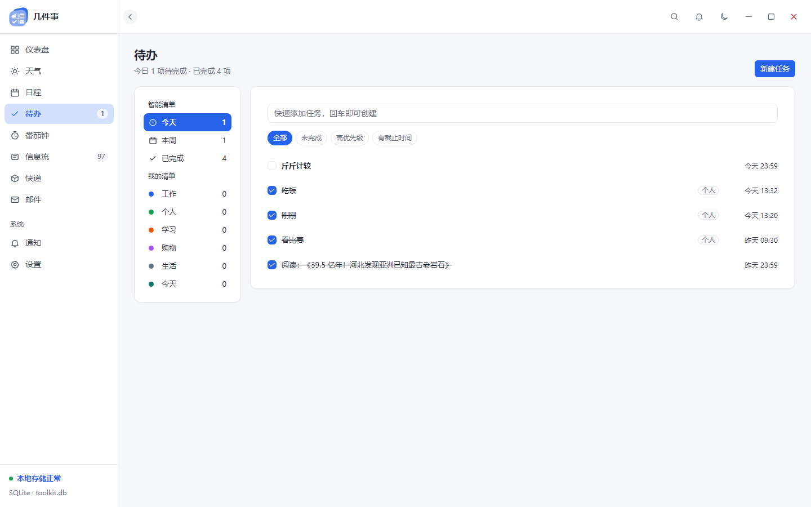
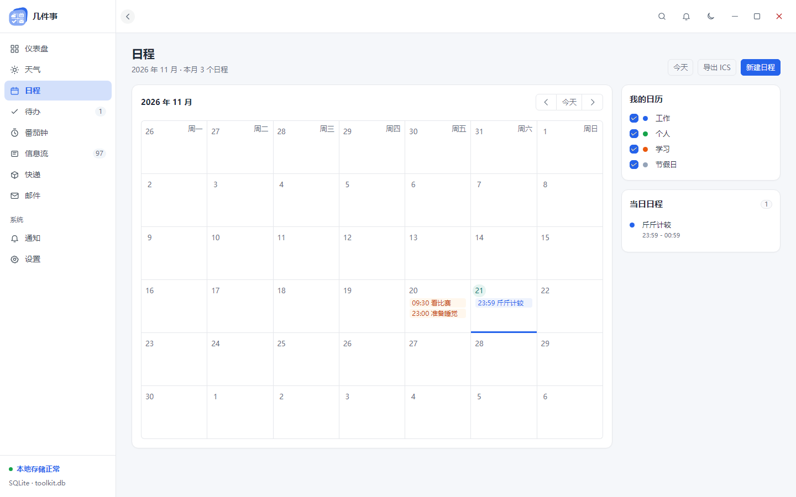

# 几件事 · Something

本地优先的 Windows 桌面效率工具。待办、日程、番茄钟、天气、快递、信息流、邮件放在同一个仪表盘里，业务数据全部落在本机 SQLite，不需要账户，也没有云端同步。

## 界面预览

仪表盘：8 张卡片同屏，可拖动换位、拖右下角缩放，布局存在本机。



| | |
| --- | --- |
| 待办<br> | 日程<br> |

## 主要功能

| 模块 | 说明 |
| --- | --- |
| 仪表盘 | 8 张卡片（天气、今日日程、待办、番茄钟、快递、信息流、邮件、通知）。卡片可拖动换位、拖右下角改大小、锁定布局、单卡隐藏与刷新，布局按网格坐标存在本机设置里 |
| 待办 | 清单分组、子任务、标签、优先级、提醒时间、看板视图、转为日程 |
| 日程 | 月/周视图、分类日历、冲突检测、提醒、ICS 导入导出、待办双向联动 |
| 番茄钟 | 真实计时与状态恢复、绑定任务、中断记录、当日统计、专注完成通知 |
| 天气 | 和风天气（JWT 或 API Key）、多城市、逐小时/7 天/空气质量/生活指数/预警 |
| 快递 | 单号跟踪、轨迹抽屉、状态分组、取件码、隐私模式、未取件转待办 |
| 信息流 | RSS/Atom 三栏阅读器、订阅源管理、OPML 导入导出、关键词规则 |
| 邮件 | 多账户 IMAP/SMTP、收件箱/发件箱、写邮件、规则抽屉；凭证用系统 safeStorage 加密 |
| 通知中心 | 事件引擎统一出「系统通知 + 应用内通知」；去重、免打扰时段、隐私摘要、按自然日分组、已读/清除 |
| 全局搜索 | `Ctrl+K` 搜索待办、日程、邮件等并直接跳转 |
| 设置 | 外观（主题/强调色/字号）、通知、窗口、数据备份与导出、快捷键、关于 |

## 技术栈

| 层 | 选型 |
| --- | --- |
| 桌面容器 | Electron 33（`contextIsolation` 开启，渲染进程无 Node 权限） |
| 界面 | Vue 3.5 + TypeScript + Vite 6，`<script setup>` 组合式 API |
| 组件库 | Naive UI 2.45（按需引入，外观统一走 `src/theme/naive.ts` 的主题变量） |
| 状态 | Pinia（只放 UI 态与视图缓存，业务数据不进常驻状态） |
| 路由 | Vue Router 4，hash 模式 |
| 数据库 | better-sqlite3（WAL），只在主进程访问 |
| 校验 | zod（所有 IPC 入参在主进程校验） |
| 卡片网格 | grid-layout-plus 1.1.1 |
| 打包 | electron-builder 26（NSIS 安装包） |

数据流：渲染进程只能通过 `window.api.<domain>.<method>()` → `electron/preload.cjs` 白名单 → `electron/ipc/registry.cjs` → `electron/services/*` → SQLite，没有通用 invoke 透传。

## 目录结构

```
electron/            主进程（CJS）
  main.cjs           窗口、托盘、生命周期、IPC 注册
  preload.cjs        contextBridge 白名单
  ipc/registry.cjs   IPC 注册与 zod 校验、错误规范化、变更广播
  services/          每个域一个 service，SQL 只写在这里
  db/                连接、事务、迁移、数据目录定位
  log/               按天切分、轮转、脱敏的日志
src/                 渲染进程（Vue）
  views/             9 个页面：Home/Weather/Schedule/Todo/Pomodoro/Feed/Parcel/Mail/Notice/Settings
  components/        Shell、品牌标识、图标 sprite、首页卡片与设置面板
  composables/       useSettings、useHomeLayout、useHomeRefresh 等
  theme/naive.ts     全部外观令牌（颜色、圆角、字号、阴影）
  styles/            只放布局的页面样式
docs/                功能设计与早期交付记录
docs/screenshots/    界面截图（本 README 引用）
migrations/          SQLite 迁移脚本
build/               打包图标资源
```

开发约定见 [AGENTS.md](AGENTS.md)：能用 Naive UI 必须用；CSS 只写布局、外观走主题变量；禁止 `:deep(.n-xxx)`；改完必须 `npx vue-tsc --noEmit` + `npm run build`。

## 开发

环境要求：Windows + Node.js 20 LTS 及以上 + npm。

```bash
npm install          # 安装依赖（含 Electron 二进制）
npm run rebuild      # 为 Electron ABI 重编译 better-sqlite3，首次或升级 Electron 后执行
npm run dev          # 同时启动 Vite 与 Electron（推荐）
```

其他命令：

| 命令 | 作用 |
| --- | --- |
| `npm run dev` | Vite + Electron 一起起，主进程改动自动重启 |
| `npm run dev:vite` | 只起 Vite，浏览器里预览界面（走 localStorage 兜底，无 IPC） |
| `npm run build` | 构建前端到 `dist/` |
| `npm start` | 不启 Vite，用已构建的 `dist/` 启动 Electron |
| `npm run rebuild` | 重新编译 better-sqlite3 原生模块 |
| `npx vue-tsc --noEmit` | TypeScript 类型检查 |

常见环境问题：

- 必须确保 `ELECTRON_RUN_AS_NODE` 未设置，否则 Electron 会退化成纯 Node，主进程报 `Cannot read properties of undefined (reading 'getPath')`，窗口起不来。`scripts/dev.cjs` 启动前会自动清掉所有 `ELECTRON_*` 变量。
- Electron 二进制下载失败时，用镜像重装：`set ELECTRON_MIRROR=https://registry.npmmirror.com/-/binary/electron/` 后执行 `node node_modules/electron/install.js`。
- better-sqlite3 与 Electron 的 ABI 必须匹配；用普通 `node` 直接跑脚本读库会报 `NODE_MODULE_VERSION` 不一致。

## 打包

```bash
npm run build                                    # 先产出 dist/
npx electron-builder --win --config.npmRebuild=false
```

`--config.npmRebuild=false` 表示打包时跳过原生模块重编译：本机的 better-sqlite3 已用 `npm run rebuild` 编译成与当前 Electron 匹配的 ABI，重复重编会尝试 unlink 正被占用的 `better_sqlite3.node` 并报 `EPERM`。首次在干净环境打包时可去掉该参数，让 electron-builder 自行 `electron-rebuild`。

产物输出到 `release/`，安装包名为 `Something-Setup-<version>.exe`（NSIS，可选安装目录，创建桌面与开始菜单快捷方式）。

打包配置在 `package.json` 的 `build` 字段：`appId com.something.jijianshi`、`productName Something`，打包内容为 `dist/` + `electron/` + `package.json`，原生模块与 `electron/assets` 通过 `asarUnpack` 解包。

## 数据与日志位置

- 数据库：`%APPDATA%\Something\toolkit.db`（WAL 模式）
- 日志：`%APPDATA%\Something\logs\app-YYYY-MM-DD.log`（按天切分、5MB 轮转、14 天保留、敏感字段脱敏）
- 若 userData 目录不可写，会回退到应用目录下的 `.data/toolkit.db`
- 设置页「数据」面板可立即备份、导出 JSON/ICS/OPML、重置数据库

## 外部服务

只有天气、快递、信息流、邮件收发需要联网，联网结果仅做本地缓存：

- 天气：和风天气控制台建项目 → 项目里创建凭据（推荐 JWT，Ed25519）→ 在应用「天气 → 数据源设置」填 API Host、开发者 ID、项目 ID、凭据 ID 与私钥；私钥与 API Key 均经系统 safeStorage 加密，仅存本机。
- 邮件：IMAP/SMTP 服务器、端口与授权码在「邮件 → 账户设置」里配置，同样加密存储。
- 信息流：直接填 RSS/Atom 地址，或导入 OPML。
