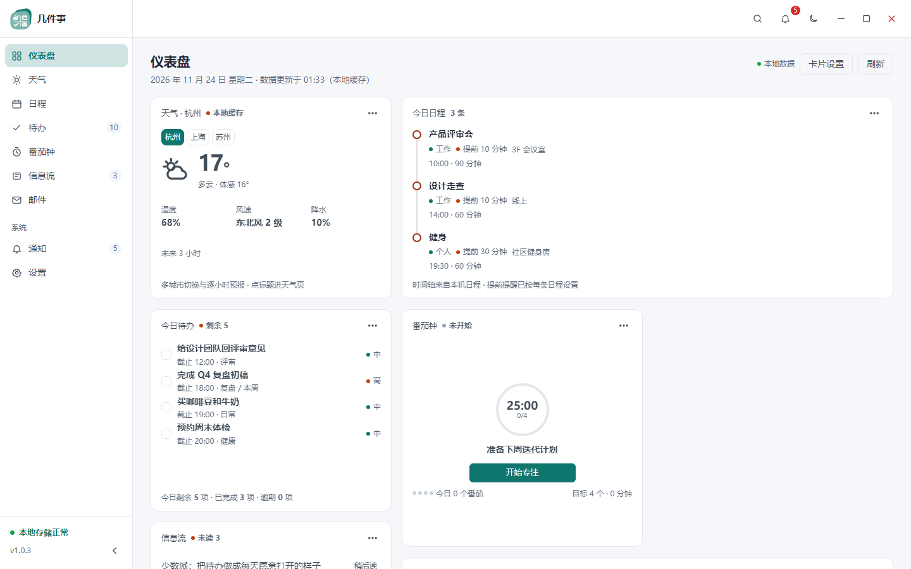
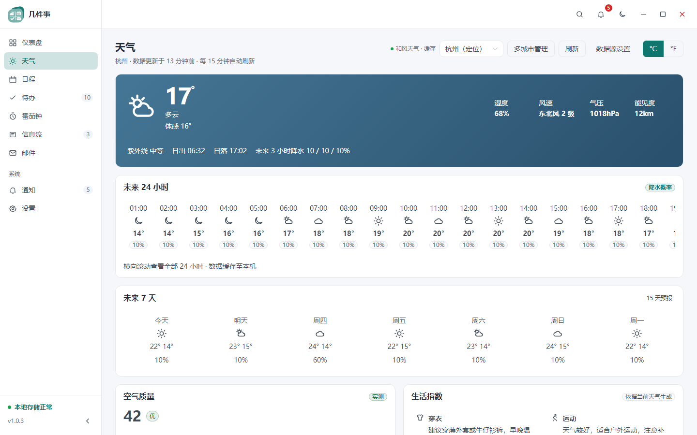
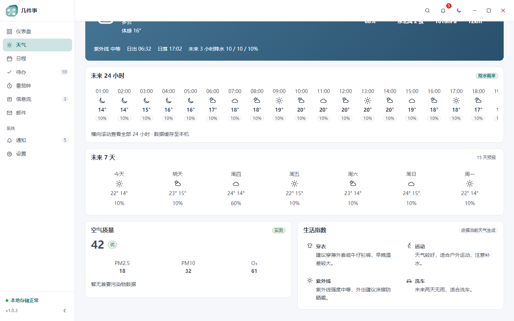
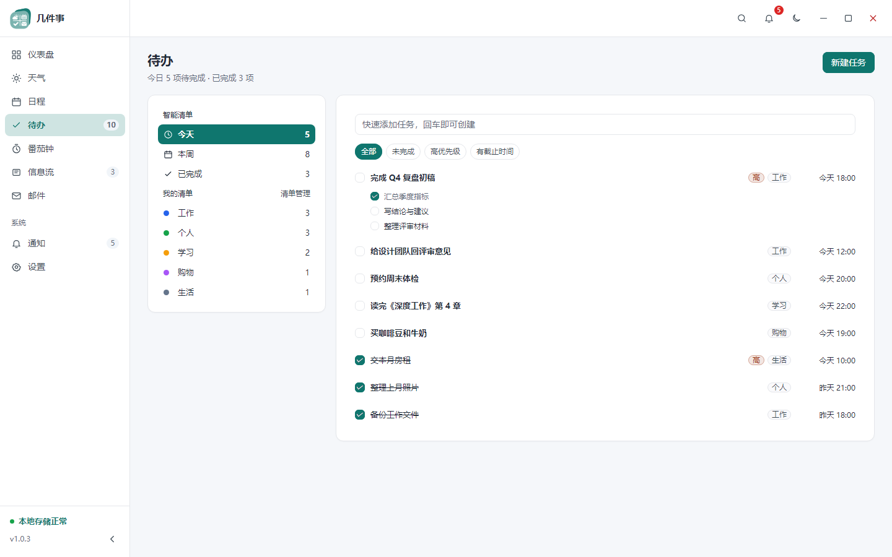
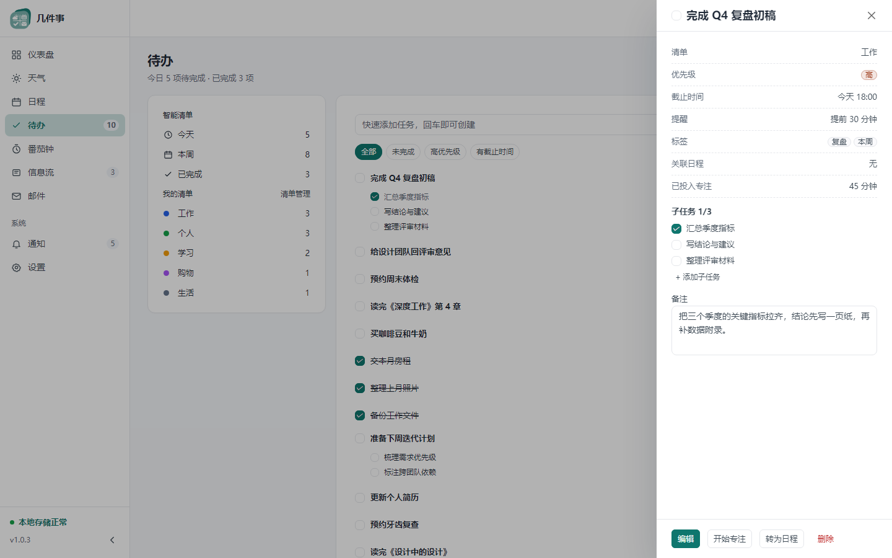
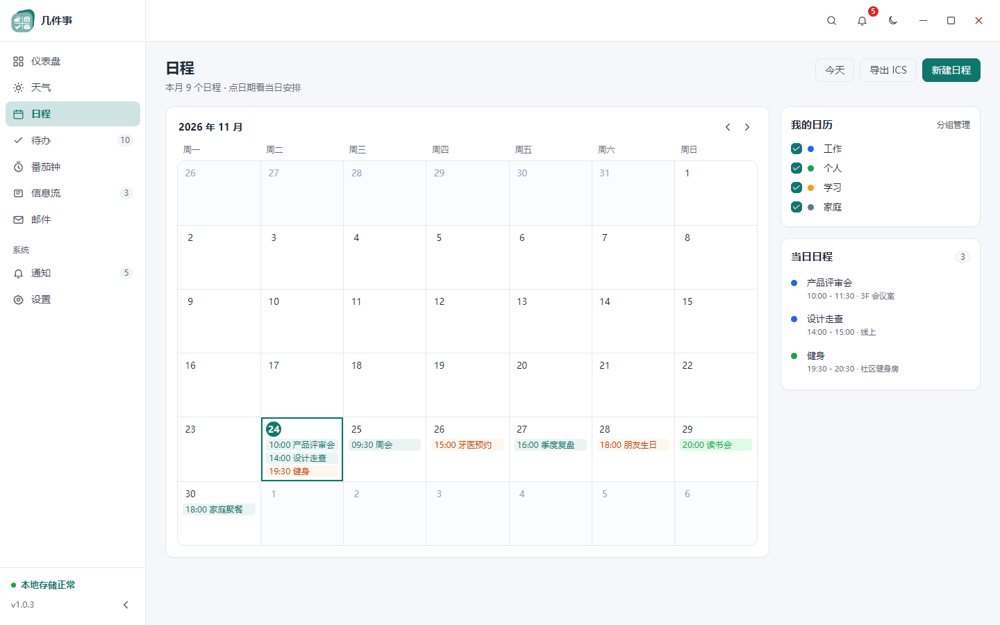
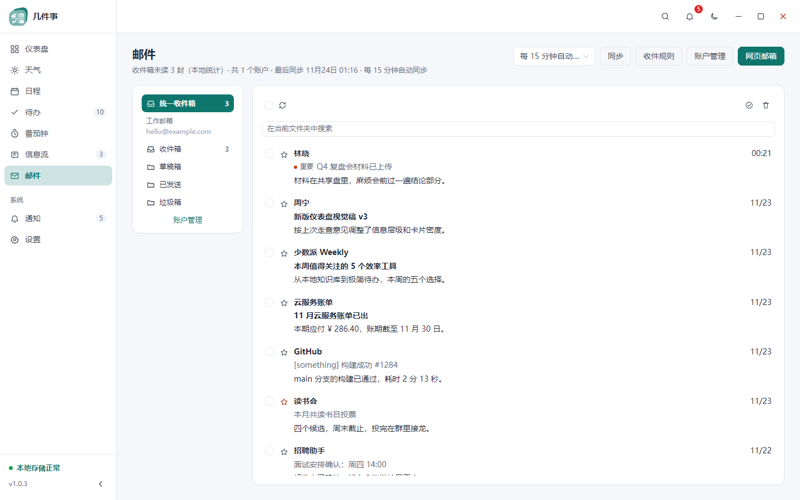
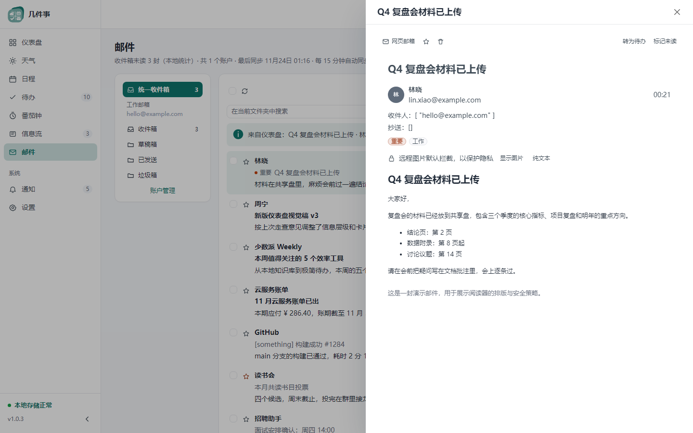
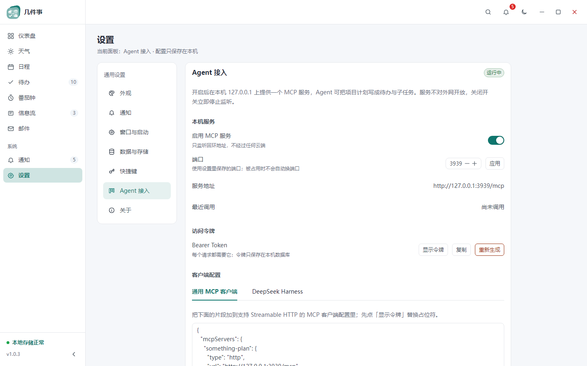

# 几件事 · Something

本地优先的 Windows 桌面效率工具。天气、待办、日程、邮件、番茄钟、快递、信息流放在同一个仪表盘里，业务数据全部落在本机 SQLite，不需要账户，也没有云端同步。

其中五条主线值得单独说明：

- **天气**：和风天气数据源，多城市、逐小时、7 天、空气质量、生活指数、预警，失败时回落到本地缓存。
- **待办**：智能清单 + 自定义清单，子任务、优先级、截止、提醒、标签，可一键转为日程或开始专注。
- **日程**：月视图排期、分类日历、冲突检测、重复规则、ICS 导入导出，与待办双向联动。
- **邮件**：多账户 IMAP 收信，统一收件箱、规则、沙箱阅读器，可把邮件转为待办。
- **MCP**：本机 MCP 服务，Agent 可以把项目计划直接写成待办与子任务，不需要账号或云端。

## 界面预览

仪表盘：8 张卡片同屏，可拖动换位、拖右下角缩放，布局存在本机。



> 本文截图使用演示数据。下面每个功能章节各配 1–2 张实拍图，可以直接看到对应界面。

## 功能总览

| 模块   | 说明                                                                          |
| ---- | --------------------------------------------------------------------------- |
| 仪表盘  | 7 张卡片（天气、今日日程、待办、番茄钟、信息流、邮件、通知）。卡片可拖动换位、拖右下角改大小、锁定布局、单卡隐藏与刷新，布局按网格坐标存在本机设置里 |
| 天气   | 和风天气（JWT 或 API Key）、多城市、逐小时/7 天/空气质量/生活指数/预警、自动刷新与本地缓存                      |
| 待办   | 智能清单与自定义清单、子任务、标签、优先级、截止时间、提醒、转为日程、Agent 计划条                                |
| 日程   | 月视图 + 当日列表、分类日历、冲突检测、提前提醒、重复规则、ICS 导入导出、待办双向联动                              |
| 邮件   | 多账户 IMAP 同步、统一收件箱、文件夹与未读统计、收件规则配置、沙箱阅读器、转为待办；写邮件/回复交给服务商网页版                 |
| MCP  | 本机 Streamable HTTP MCP 服务，四个项目计划工具，Bearer 令牌鉴权，只监听回环地址                      |
| 番茄钟  | 真实计时与状态恢复、绑定任务、中断记录、当日统计、专注完成通知                                             |
| 信息流  | RSS/Atom 三栏阅读器、订阅源管理、OPML 导入导出、关键词规则                                        |
| 通知中心 | 事件引擎统一出「系统通知 + 应用内通知」；去重、免打扰时段、隐私摘要、按自然日分组、已读/清除                            |
| 全局搜索 | `Ctrl+K` 搜索待办、日程、邮件等并直接跳转                                                   |
| 设置   | 外观（主题/强调色/字号）、通知、窗口与启动、数据与存储（备份/导出/恢复/重置）、快捷键、Agent 接入、关于                   |

## 天气

数据来自和风天气，配置与页面在「天气 → 数据源设置」里，不再跳转到设置页。



*当前天气、24 小时与 7 天预报同屏；右上角切换城市、温度单位与数据源。*

### 数据源与凭据

- **JWT（推荐）**：Ed25519 私钥在本机签名，请求只携带 15 分钟短期 Token，密钥本身不上传输链路。需要填写 API Host、开发者 ID、项目 ID、凭据 ID 与私钥。
- **API Key（兼容）**：直接填 API Host 与 Key，适合已经发好的旧凭据。
- 两种方式二选一，面板里只显示选中的那套字段；填完可以点「测试连接」做一次真实请求自检。
- 凭据以明文保存在本机数据库的 `app_setting` 里（`weatherKey` / `qweatherJwt`），设置界面默认掩码，需要时点「显示已保存」查看。应用没有云端，凭据不会离开本机。

### 页面能力

- **当前天气**：温度、天气现象、体感，以及湿度、风速、气压、能见度四项指标；Hero 背景按天气现象取色，文字对比度按 WCAG AA 校准。
- **24 小时**：横向滚动，含逐小时图标、温度与降水概率。
- **7 天**：每天最高/最低温、天气图标、降水概率；「今天」单独标注。
- **空气质量**：AQI 数值、等级与主要污染物。
- **生活指数**：穿衣、洗车、运动等常用指数。
- **预警**：和风天气的预警列表，顶部出现预警条，也可从「天气预警与提醒」弹窗查看完整内容与当日通知流。
- **自动刷新**：默认每 5 分钟静默刷新一次，间隔来自设置 `weather.refreshMin`，页面标题下方显示「数据更新于 … · 每 N 分钟自动刷新」。
- **数据来源标签**：明确区分「和风天气」「和风天气 · 缓存」「本地缓存」「未配置数据源」；取数失败时保留最近一次缓存并显示具体原因，离线也能看到上次结果。



*向下滚动是空气质量与生活指数；这一屏同时能看到逐小时与 7 天预报。*

### 多城市

- 通过和风天气 GeoAPI 搜索城市后添加，支持设默认城市、切换查看、删除。
- 「定位」用于重新获取当前城市；定位得到的城市不可删除，避免误删后没有默认位置。
- 城市管理器里逐个城市显示当前温度，数据来自各自缓存或即时请求。
- 温度单位支持摄氏度 / 华氏度切换，切换后所有温度与能见度展示同步换算。

### 通知

通知中心的天气播报每天 9 / 12 / 17 / 20 点各一次，内容取自最近一次本地缓存，不额外联网。

## 待办

三栏结构：左栏清单，中栏任务列表，右栏详情抽屉。所有数据在本机 SQLite，渲染进程只通过 `window.api.todo.*` 访问。



*智能清单、自定义清单与任务列表；行内就能完成、看子任务与截止时间。*

### 清单

- **智能清单**：今天、本周、已完成，带实时计数。今天/本周按截止时间归类，已完成按状态筛选。
- **自定义清单**：可新建、改名、删除；删除前会统计受影响任务数并提示，确认后把任务迁移到其他清单。
- **默认清单**：只能改名，不能删除，作为删除其他清单时的兜底目标。
- **清单管理**：一个弹窗集中处理新建与改名；新建任务时清单下拉也支持直接输入新清单名。

### 任务

- **快速添加**：在列表顶部输入标题回车即可创建，默认落在当前清单。
- **筛选**：全部 / 未完成 / 高优先级 / 有截止时间。
- **列表行**：完成勾选、优先级标签、所属清单、截止时间（过期标红）、行内子任务勾选，不用打开详情就能推进。
- **详情抽屉**：清单、优先级、截止时间、提醒时间、标签、关联日程、已投入专注（`focusSeconds`）、子任务增删改、备注。
- **操作**：编辑、开始专注（跳到番茄钟并绑定任务）、转为日程、删除。
- **已完成任务**：详情只读，避免误改历史记录。
- **提醒**：待办在提醒时间与到期时各提醒一次，去重与免打扰由通知中心统一处理。



*详情抽屉：优先级、截止、提醒、标签、关联日程、已投入专注、子任务与备注都在这里；底部是编辑、开始专注、转为日程与删除。*

### Agent 计划条

通过 MCP 写入的项目计划会在对应清单顶部显示一条计划信息：计划标题、第 N 次写入（`revision`）、摘要、完成进度、仓库路径（`repoPath`）。这条信息只读，用于确认 Agent 最近一次写入的内容；任务本身仍然是普通待办，可以手动勾选、改期或删除。

## 日程

日程页是「月视图 + 选中日列表」：左边整月网格，右边当日安排。



*左侧整月网格，右侧当日安排；分类颜色来自「我的日历」。*

### 月视图

- 7 列网格，周一为首列；月初向前补到整周，月末整行都是下月日期时裁掉。
- 今天与选中日期分别高亮；标题下方显示本月日程总数，提示「点日期看当日安排」。
- 点某天只切换当日列表；点到上/下月的日期时，面板会顺带切到对应月份。
- 月视图只加载当月事件，跨月重复的条数由主进程统计，避免提示漏算。

### 事件

- **新建/编辑**：标题、开始与结束时间、地点、分类、提醒（默认提前 10 分钟）、重复（不重复 / 每天 / 每周 / 每月）、备注。
- **分类日历**：工作、个人、学习、节假日等来自数据库的分类，可显示/隐藏、新建、改名、删除；删除分类时该分类下的日程统一迁移到默认分组。
- **冲突检测**：保存前检查同一天内相邻事件是否时间重叠，有冲突时提示「A 与「B」时间冲突」，由用户决定是否继续。
- **详情抽屉**：查看完整信息，可编辑、删除，或**转为待办**。
- **提醒**：按每条记录自己的提前量触发，由通知中心统一去重、免打扰与隐私摘要。
- **深链定位**：从全局搜索或通知跳转过来时，如果目标在别的月份，先按 id 取真实开始时间、切月重载，再打开详情并高亮。

### 与待办联动

- **日程 → 待办**：标题、备注、关联日程 ID 一并带过去；截止时间取日程开始时间，保证在待办里能按「今天/本周」正确归类；清单优先映射同名分类，没有同名清单就落到默认清单。
- **待办 → 日程**：待办详情里的「转为日程」会带着标题进入新建日程流程，并在两边保留关联。
- **ICS**：支持导出当前范围为 `.ics`，也支持导入外部日历文件；导入的事件按分类落库，可继续编辑。

## 邮件

邮件是本地优先的 IMAP 收信客户端：正文、附件索引、已读状态都落在本机 SQLite，联网只用于同步与打开网页邮箱。



*统一收件箱与各账户文件夹；未读、星标、附件与摘要都在列表里。*

### 账户

- 添加账户时填写：别名、邮箱地址、协议、IMAP 主机与端口、SMTP 主机与端口、用户名、授权码、同步范围（最近 7 / 30 / 90 天或全部）、是否启用。
- **测试连接**会分别验证 IMAP 与 SMTP，失败时给出具体阶段与原因。
- 停用账户后，它的文件夹、邮件与未读统计会从邮件页完全隐藏，但本地数据保留。
- 删除账户会一并移除该账户的本地缓存邮件。
- 同步当前只支持 IMAP；账户表单里的 POP3 选项尚未接入同步实现。
- 授权码以明文保存在本机数据库（设置界面默认掩码，可切换查看），不会上传到任何服务。

### 同步

- 顶部「同步」按钮手动拉取全部启用账户；也可以设置自动同步：关闭 / 每 5 / 15 / 30 / 60 分钟，开关后由主进程轮询生效。
- 每次同步拉取每个账户收件箱最近 20 封（上限 50），并额外补齐服务器上最多 100 封未读，避免「只同步最近 N 封」导致更早的未读永远统计不到。
- 已读/未读以**本地库为准**：同步只刷新标题、摘要、正文与星标，绝不把本地读过的邮件覆盖回未读。
- 状态栏显示启用账户数、最后同步时间与当前自动同步频率。

### 列表与阅读

- **左栏**：统一收件箱、各账户、系统文件夹（收件箱 / 已发送 / 草稿箱 / 垃圾箱）与未读数。
- **中栏**：星标、附件图标、发件人、主题、摘要、时间；未读加粗；支持在当前文件夹内搜索；支持批量标记已读与删除。
- **阅读抽屉**：
  - 网页邮箱打开、星标、标记未读、删除、**转为待办**。
  - HTML / 纯文本一键切换。
  - 远程图片默认拦截，需要时手动「显示图片」，避免打开邮件就被追踪像素。
  - 正文在无脚本的沙箱 iframe 中渲染，并带 CSP，邮件里的脚本不会碰到应用页面。
  - 附件以列表展示文件名与大小（只保存附件索引，不把附件正文落库）。
- **转为待办**：标题取邮件主题，备注写入「来自 发件人」加正文前 300 字，截止时间设为今天，来源标记为邮件，之后可在待办页继续拆子任务或排期。



*阅读抽屉：工具栏可打开网页邮箱、星标、删除、转为待办、标记未读；正文在沙箱 iframe 中渲染，远程图片默认拦截。*

### 收件规则

可按「发件人 / 主题 / 正文」+「包含 / 等于」配置条件，动作有加标签、标记重要、静默；规则带优先级与启停开关，可在抽屉里新建、编辑。

> 当前版本规则只负责保存配置，尚未在同步时自动执行；邮件仍按原始内容进入收件箱。

### 边界

写邮件、回复与转发**不在应用内完成**：按账户邮箱域名打开对应服务商的网页版，交给系统浏览器。这样不需要在本地保存 SMTP 发信凭据，也避免自建发信通道被当成垃圾邮件。

## MCP：让 Agent 把计划写进待办

「几件事」内置一个本机 MCP 服务。Agent 连接后可以把某个项目的计划直接写成清单、待办与子任务，不需要复制粘贴，也不需要云端账号。设计细节见 [docs/design/MCP接入.md](docs/design/MCP接入.md)。



*设置 → Agent 接入：开关、端口、服务地址、Bearer 令牌与客户端配置片段都在这一页；截图里服务运行在 3939 端口。*

### 形态

| 项 | 取值 |
| --- | --- |
| 传输 | MCP Streamable HTTP，单端点 `POST /mcp` |
| 协议 | JSON-RPC 2.0，只实现 tools 能力，无 session、无 SSE |
| 监听 | 仅 `127.0.0.1`，不对外网开放 |
| 鉴权 | `Authorization: Bearer <token>`，令牌 32 字节随机 hex |
| 协议版本 | 响应 `2025-06-18`，兼容客户端的 `2025-03-26` / `2024-11-05` |
| 默认状态 | 关闭（`mcp.enabled=false`），不监听任何端口 |

### 四个工具

| 工具 | 作用 |
| --- | --- |
| `project_plan_write` | 写入/更新一份项目计划：项目信息 + 条目列表，返回 revision 与创建/更新/删除计数 |
| `project_plan_read` | 按 `project.key` 或 `project.name` 读回项目、revision、进度与全部条目（含子任务 key 与 done） |
| `project_plan_item_update` | 只改一个条目：状态 / 完成 / 备注 / 优先级 / 截止，或新增、更新一个子任务 |
| `project_plan_list` | 列出本机所有已接入项目：projectKey、清单名、标题、revision、最近写入时间、完成进度 |

写入示例：

```json
{
  "project": { "key": "something", "name": "Something", "repoPath": "E:/repo" },
  "plan": {
    "title": "v1.1 计划",
    "summary": "可选的整体说明",
    "version": "1.1",
    "items": [
      {
        "key": "mcp-server",
        "title": "实现 MCP 服务",
        "status": "进行中",
        "priority": "高",
        "dueAt": "2026-12-01T18:00:00+08:00",
        "labels": ["阶段一"],
        "subtasks": [{ "key": "handler", "title": "路由与鉴权", "done": true }]
      }
    ]
  },
  "mode": "merge"
}
```

### 数据映射

| 计划概念 | 落库位置 | 说明 |
| --- | --- | --- |
| 项目 | `todo_list` 一行 + `project_plan` 一行 | 清单名 = 项目名；一个清单最多绑定一个项目 |
| 计划条目 | `todo`，`source_type='plan'` | `source_ref='<projectKey>:<itemKey>'`，按 key 幂等更新 |
| 阶段/拆解 | `todo_subtask`，`source_ref='<itemKey>:<subKey>'` | 不建阶段层级，用 `labels` 表达阶段 |
| 计划元信息 | `project_plan` | title / summary / version / revision / repo_path / last_writer |

`revision` 每次写入 +1，待办页的计划条据此显示「第 N 次写入」。

### 写入语义

- `item.key` 可省略；省略时服务端用 `k+sha1(title)[0:10]` 稳定派生，重复提交不会产生重复待办。建议显式传 key，标题改动时也不会产生新条目。
- `mode=merge`（默认）：只 upsert 本次提交的条目，不动其他条目。
- `mode=replace`：额外删除本次未提交的旧计划条目，但只删「用户未完成、未投入专注、未关联日程」的，避免误删用户成果。
- 未显式传入的 `status/done/note/priority/dueAt/labels` 不会覆盖库里已有值，保护用户手动勾选；显式传 `null` 表示清空。

### 错误约定

工具业务错误通过 `tools/call` 的 `isError: true` + 文本 `CODE: message` 返回：

| CODE | 含义 |
| --- | --- |
| `INVALID_ARGS` | 入参不满足 schema（附字段路径） |
| `PROJECT_NOT_FOUND` | read/update 时项目不存在 |
| `PROJECT_KEY_MISMATCH` | 清单已绑定其他 projectKey |
| `LIST_IS_DEFAULT` | 不能把默认清单当项目 |
| `ITEM_NOT_FOUND` / `SUBTASK_NOT_FOUND` | 条目 / 子任务不存在 |
| `LIST_NAME_TAKEN` | 新建项目名与已有清单冲突 |

协议层错误用 JSON-RPC：`-32700` 解析失败、`-32600` 非法请求、`-32601` 方法不存在、`-32602` 参数缺失、`-32603` 工具执行异常。

### 安全边界

- 只监听回环地址；校验 `Host` 与 `Origin` 只允许 `127.0.0.1` / `localhost`，挡住 DNS rebinding。
- 所有请求必须带 Bearer 令牌；比较用 `crypto.timingSafeEqual`，令牌每次请求现取，轮换后旧令牌立即失效。
- 请求体上限 1 MiB；`Content-Type` 必须是 `application/json`；响应 `Cache-Control: no-store`。
- 端口被占用时启动失败并保留 `lastError`，不自动漂移到其他端口，避免客户端配置静默失效。
- 日志只记工具名、成功与否、耗时与计数，不记计划正文与令牌。

### 端口

| 场景 | 默认端口 | 说明 |
| --- | --- | --- |
| 开发（`npm run dev` / 未打包） | `3927` | 数据目录 `<repo>/.data` |
| 安装版 | `3928` | 数据目录 `%APPDATA%\Something`（或 exe 同级 `data/`） |
| `TK_MCP_PORT` 环境变量 | 以变量为准 | 合法范围 1024-65535，设置面板会显示来源并锁住端口输入 |
| 设置里手动改端口 | 以设置为准 | 点「应用」后立即重启监听 |

优先级：`TK_MCP_PORT` > 设置里的端口 > 按运行方式默认。设置项 `mcp.port` 默认 `null`，只切开关不会把默认端口写进设置。

### 接入步骤

1. 打开「设置 → Agent 接入」，启用 MCP 服务；需要时改端口并点「应用」。
2. 点「显示令牌」并复制。
3. 复制「客户端配置」到支持 Streamable HTTP 的 MCP 客户端，把令牌填进 `Authorization`。

```json
{
  "mcpServers": {
    "something-plan": {
      "type": "http",
      "url": "http://127.0.0.1:3927/mcp",
      "headers": { "Authorization": "Bearer <TOKEN>" }
    }
  }
}
```

DeepSeek Harness 使用 `@deepseek-ai/dsh-mcp-client` 插件，配置写在 profile 的 `cordis.patch.yml`（Windows 默认 `%USERPROFILE%\.dsh\profiles\desktop\cordis.patch.yml`）：

```yaml
- insert:
    - id: something-plan
      name: '@deepseek-ai/dsh-mcp-client'
      config:
        serverName: something-plan
        transport: streamable-http
        url: http://127.0.0.1:3927/mcp
        headers:
          Authorization: Bearer <TOKEN>
        reconnect: { enabled: true, initialDelayMs: 1000, maxDelayMs: 30000, maxAttempts: 30 }
```

重启 Harness 生效；条目 `id` 不能与已有条目重复，已有同名服务时直接改原条目即可。关闭开关会立即停止监听，应用退出时也会停止。

## 技术栈

| 层 | 选型 |
| --- | --- |
| 桌面容器 | Electron 33（`contextIsolation` 开启，渲染进程无 Node 权限） |
| 界面 | Vue 3.5 + TypeScript + Vite 6，`<script setup>` 组合式 API |
| 组件库 | Naive UI 2.45（按需引入，外观统一走 `src/theme/naive.ts` 的主题变量） |
| 状态 | Pinia（只放 UI 态与视图缓存，业务数据不进常驻状态） |
| 路由 | Vue Router 4，hash 模式 |
| 数据库 | better-sqlite3（WAL），只在主进程访问 |
| 校验 | zod（所有 IPC 入参在主进程校验） |
| 卡片网格 | grid-layout-plus 1.1.1 |
| MCP | 本机 Streamable HTTP + JSON-RPC 2.0，Bearer 令牌，无第三方 MCP 框架 |
| 打包 | electron-builder 26（NSIS 安装包） |

数据流：渲染进程只能通过 `window.api.<domain>.<method>()` → `electron/preload.cjs` 白名单 → `electron/ipc/registry.cjs` → `electron/services/*` → SQLite，没有通用 invoke 透传。

MCP 的数据流是独立的：客户端 → `POST /mcp` → `electron/mcp/server.cjs`（鉴权 + JSON-RPC）→ `electron/mcp/tools.cjs`（schema + 调度）→ `electron/services/project.cjs` → 同一套 SQLite，不经过渲染进程。

## 目录结构

```
electron/            主进程（CJS）
  main.cjs           窗口、托盘、生命周期、IPC 注册、MCP 生命周期
  preload.cjs        contextBridge 白名单
  ipc/registry.cjs   IPC 注册与 zod 校验、错误规范化、变更广播
  services/          每个域一个 service，SQL 只写在这里
  mcp/               本机 MCP 服务：server.cjs（HTTP/鉴权/分发）、tools.cjs（工具 schema）
  db/                连接、事务、迁移、数据目录定位
  log/               按天切分、轮转、脱敏的日志
src/                 渲染进程（Vue）
  views/             10 个页面：Home/Weather/Schedule/Todo/Pomodoro/Feed/Parcel/Mail/Notice/Settings
  components/        Shell、品牌标识、图标 sprite、首页卡片与设置面板
  composables/       useSettings、useHomeLayout、useHomeRefresh 等
  theme/naive.ts     全部外观令牌（颜色、圆角、字号、阴影）
  styles/            只放布局的页面样式
docs/                功能设计与交付记录
docs/design/MCP接入.md  MCP 协议、工具、数据映射与配置说明
docs/screenshots/    界面截图（本 README 引用）
migrations/          SQLite 迁移脚本（012 引入 project_plan）
build/               打包图标资源
```

开发约定见 [AGENTS.md](AGENTS.md)：能用 Naive UI 必须用；CSS 只写布局、外观走主题变量；禁止 `:deep(.n-xxx)`；改完必须 `npx vue-tsc --noEmit` + `npm run build`。

## 开发

环境要求：Windows + Node.js 20 LTS 及以上 + npm。

```bash
npm install          # 安装依赖（含 Electron 二进制）
npm run rebuild      # 为 Electron ABI 重编译 better-sqlite3，首次或升级 Electron 后执行
npm run dev          # 同时启动 Vite 与 Electron（推荐）
```

其他命令：

| 命令 | 作用 |
| --- | --- |
| `npm run dev` | Vite + Electron 一起起，主进程改动自动重启 |
| `npm run dev:vite` | 只起 Vite，浏览器里预览界面（走 localStorage 兜底，无 IPC） |
| `npm run build` | 构建前端到 `dist/` |
| `npm start` | 不启 Vite，用已构建的 `dist/` 启动 Electron |
| `npm run rebuild` | 重新编译 better-sqlite3 原生模块 |
| `npx vue-tsc --noEmit` | TypeScript 类型检查 |

常见环境问题：

- 必须确保 `ELECTRON_RUN_AS_NODE` 未设置，否则 Electron 会退化成纯 Node，主进程报 `Cannot read properties of undefined (reading 'getPath')`，窗口起不来。`scripts/dev.cjs` 启动前会自动清掉所有 `ELECTRON_*` 变量。
- Electron 二进制下载失败时，用镜像重装：`set ELECTRON_MIRROR=https://registry.npmmirror.com/-/binary/electron/` 后执行 `node node_modules/electron/install.js`。
- better-sqlite3 与 Electron 的 ABI 必须匹配；用普通 `node` 直接跑脚本读库会报 `NODE_MODULE_VERSION` 不一致。

## 打包

```bash
npm run build                                    # 先产出 dist/
npx electron-builder --win --config.npmRebuild=false
```

`--config.npmRebuild=false` 表示打包时跳过原生模块重编译：本机的 better-sqlite3 已用 `npm run rebuild` 编译成与当前 Electron 匹配的 ABI，重复重编会尝试 unlink 正被占用的 `better_sqlite3.node` 并报 `EPERM`。首次在干净环境打包时可去掉该参数，让 electron-builder 自行 `electron-rebuild`。

产物输出到 `release/`，安装包名为 `Something-Setup-<version>.exe`（NSIS，可选安装目录，创建桌面与开始菜单快捷方式）。

打包配置在 `package.json` 的 `build` 字段：`appId com.something.jijianshi`、`productName Something`，打包内容为 `dist/` + `electron/` + `package.json`，原生模块与 `electron/assets` 通过 `asarUnpack` 解包。

### 一键发布：`npm run release`

```bash
npm run release              # 类型检查 -> 构建 -> 打包 -> 打标签 -> 推送 -> 上传 Release
npm run release -- --status  # 只看每一步的状态，不动任何文件
```

七步按顺序执行：`typecheck -> build -> package -> tag -> pushBranch -> pushTag -> release`。任何一步失败或按了 Ctrl+C 之后，进度按版本号存进 `release/.release-state/v<version>.json`，再跑一次会从第一个没完成的步骤继续：已经打好的安装包、已经写好的 tag 消息都不会重来。打包、推送、上传都有行内进度（已传输字节 / 百分比 / 速度 / 预计剩余），每一步开始和结束各有一行状态。

几个实用开关：

| 开关 | 作用 |
| --- | --- |
| `--status` | 打印每步状态与下一步，不执行 |
| `--reset` | 丢掉存档，七步全部重跑 |
| `--skip-build` | 沿用 `dist/` 与 `release/` 里现有的安装包 |
| `--skip-push` | 只打包 + 打本地标签，不推送 |
| `--skip-upload` | 不创建、不更新 GitHub Release |
| `--edit` | 用 `$EDITOR` 改 tag 消息（会重打标签并重传 Release） |
| `--notes-file <file>` | 用自己写好的发布说明 |
| `--yes` | 跳过交互确认 |

`--skip-*` 跳过的步骤仍然记作 `pending`，所以命令末尾会写 `pending: ...` 和下次从哪一步继续；这种「故意没发完」的退出码仍是 0。上传 Release 需要 `GITHUB_TOKEN` / `GH_TOKEN`，两个都没有时复用 git 里已存的 github.com 凭据。

## 数据与日志位置

- 数据库：`%APPDATA%\Something\toolkit.db`（WAL 模式）
- 日志：`%APPDATA%\Something\logs\app-YYYY-MM-DD.log`（按天切分、5MB 轮转、14 天保留、敏感字段脱敏）
- 若 userData 目录不可写，会回退到应用目录下的 `.data/toolkit.db`
- 设置页「数据与存储」面板可立即备份、导出 JSON/ICS/OPML/EML、从备份恢复、重置数据库

## 外部服务

只有天气、快递、信息流、邮件同步需要联网，联网结果仅做本地缓存：

- 天气：和风天气控制台建项目 → 项目里创建凭据（推荐 JWT，Ed25519）→ 在应用「天气 → 数据源设置」填 API Host、开发者 ID、项目 ID、凭据 ID 与私钥；私钥与 API Key 以明文保存在本机数据库，界面默认掩码，可随时清除。
- 邮件：IMAP 服务器、端口、用户名与授权码在「邮件 → 账户管理」里配置；同步与收信走 IMAP，写邮件/回复走服务商网页版。授权码同样以明文保存在本机数据库，界面默认掩码。
- 信息流：直接填 RSS/Atom 地址，或导入 OPML。

应用不提供账户注册与登录，没有云端同步；WebDAV、S3、GitHub 等同步能力不属于本项目。

## 开源许可

本项目采用 [MIT 许可证](LICENSE)，全文见仓库根目录的 `LICENSE`。

可以自由使用、修改、分发，包括商业用途；只需在副本或衍生作品中保留原始的版权声明与许可声明。软件按「现状」提供，不附带任何明示或默示的担保。

「设置 → 关于 → 开源许可」里列出的是第三方依赖各自的协议（Vue、Vue Router、Pinia、Naive UI、better-sqlite3、zod、Electron 均为 MIT），与本项目自身的协议相互独立。


